

# 📊 ROAS Pulse — AI-Powered ROAS & CPA Analytics Dashboard

**Unified Multi-Platform Ad Analytics, Ad Fatigue Detection & AI Financial Reporting for E-Commerce & Agencies**

[🇺🇸 English Version](#-english-version) • [🇸🇦 النسخة العربية](#-النسخة-العربية)

---

## 🌐 English Version

**ROAS Pulse** is an all-in-one cloud SaaS platform designed to unify ad campaign performance and financial reporting for performance marketers, marketing agencies, and e-commerce store owners — built and developed by **[Mohamed Seteit](https://github.com/MohamedSeteit)**.

🔗 **Live Application:** [https://roas-pulse.vercel.app/](https://roas-pulse.vercel.app/)

---

### 🎯 Who Is This Built For? (Built for E-Commerce Growth)

**ROAS Pulse** helps merchants and media buyers scaling stores on regional and global e-commerce platforms — including **Salla (سلة)**, **Zid (زد)**, **Shopify**, **EasyOrders**, and **WooCommerce** — connect their ad spend directly to real revenue and calculate true **CPA** and **ROAS** across every major ad channel in a single dashboard:

- **Snapchat Ads**
- **TikTok Ads**
- **Meta Ads** *(Facebook & Instagram)*
- **Google Ads** *(Search, Shopping & Performance Max)*

---

### 📸 Platform Walkthrough (Screenshots)

#### 1. Executive KPIs
Real-time tracking of Total Ad Spend, Gross Revenue, Estimated Net Profit, Return on Ad Spend (**ROAS**), Cost Per Acquisition (**CPA**), Average Order Value (**AOV**), and Conversion Rate.

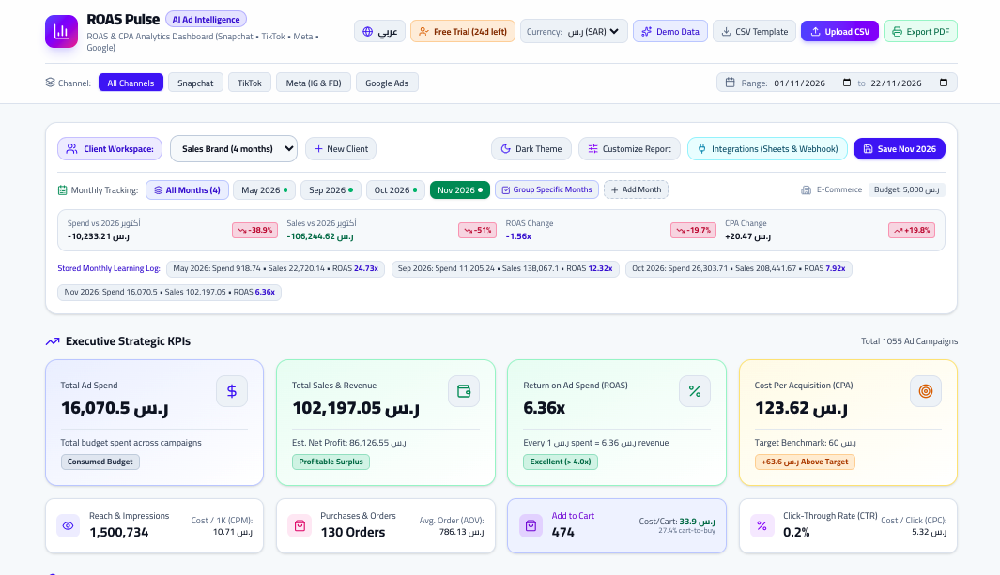

#### 2. Visual Performance Analytics & Time-Series Trends
Daily and campaign-level comparisons between ad spend and revenue to pinpoint peak sales days, pacing shifts, and performance fluctuations.

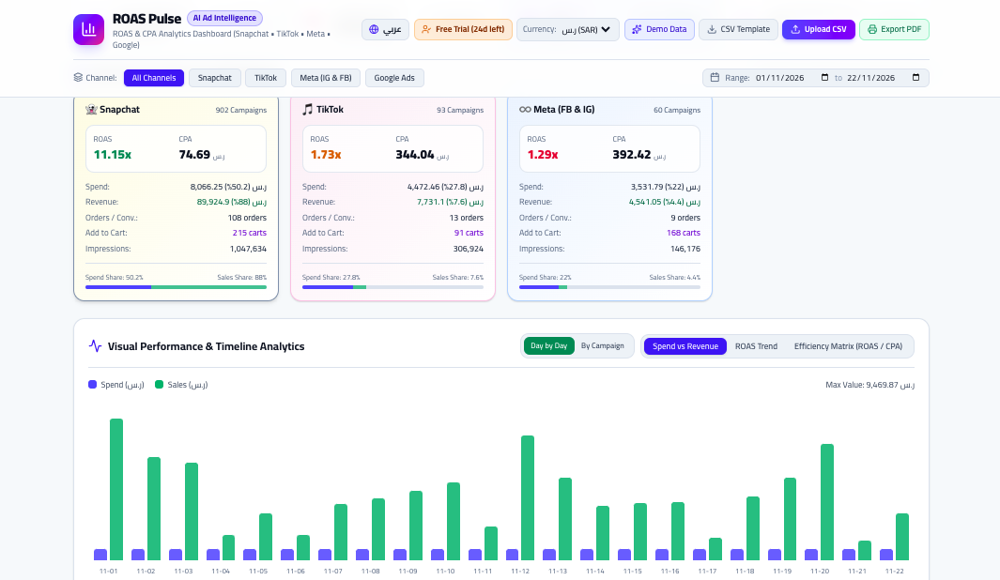

#### 3. Day-by-Day Breakdown & Ad Fatigue Detection
Granular daily stability monitoring that flags rising CPA and declining CTR early before creative fatigue drains your budget.

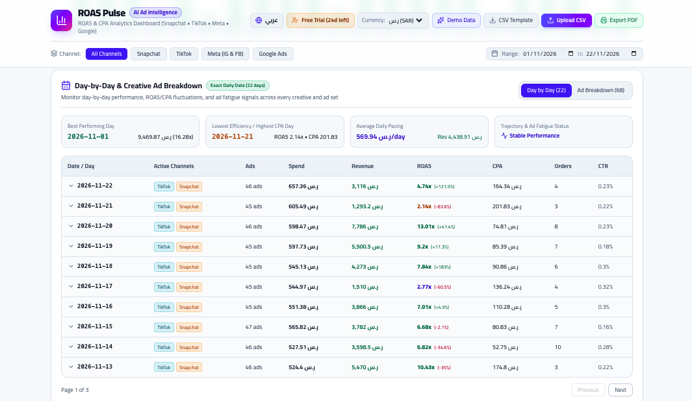

#### 4. Campaigns Drilldown & Efficiency Scoring
Multi-level hierarchy drilldown (Campaign → Ad Set → Ad) with automated tier classification (**Scale Up**, **Strong & Profitable**, **Needs Optimization**, or **Bleeding / Pause**) to simplify budget allocation decisions.

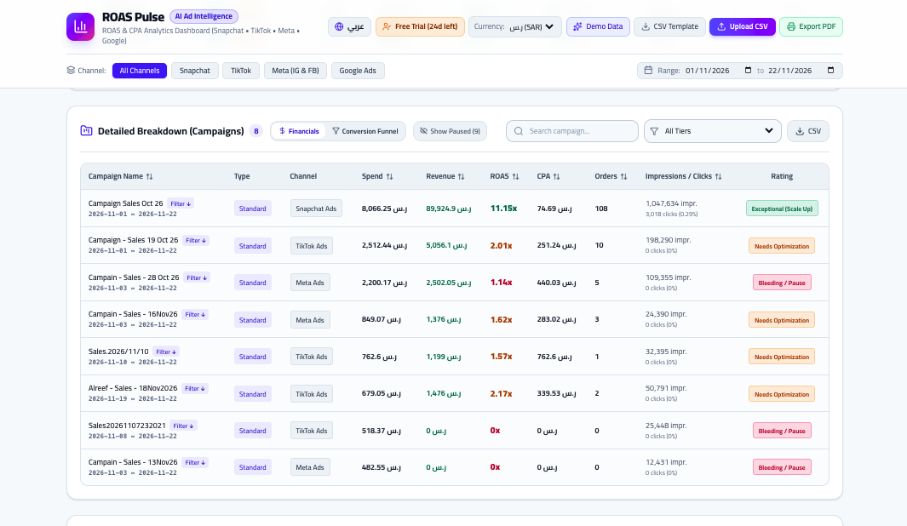

#### 5. AI Decision & Growth Center
Actionable growth command center highlighting immediate scaling candidates, budget-draining ads to pause, and real-time profit optimization opportunities across channels.

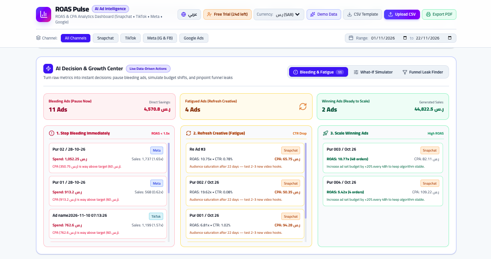

#### 6. Cumulative AI Campaign Intelligence
Deep Month-over-Month historical analysis powered by AI, delivering an executive summary, wasted-spend diagnosis, creative actions, and a data-backed budget reallocation plan.

---

### ✨ Key Technical Features

- **Client MoM Workspace:** Manage multiple client accounts or stores, save monthly performance snapshots, and track automatic Month-over-Month (MoM) growth benchmarks.
- **Automated Integrations:** Direct **Google Sheets** sync, smart **CSV** uploader with ready-to-use platform templates, and real-time **Webhooks** (compatible with **Zapier**, **Make**, and **n8n**).
- **Customizable White-Label PDF Reports:** Export print-ready executive reports featuring high-resolution charts and your custom agency or store branding.
- **Multi-Currency & Bilingual Interface:** Full support for **SAR (ر.س)**, **EGP (ج.م)**, **AED (د.إ)**, and **USD ($)** with instant English & Arabic UI switching.

---

### 💳 Subscription Plan

- **30-Day Free Trial** upon signing up with your email.
- **$2.95 / month** after the trial ends — cancel anytime with zero lock-in.

---

### 👨‍💻 Author

Designed and developed by **Mohamed Seteit** — *Performance Marketing Manager*.

- 🌐 **Live App:** [https://roas-pulse.vercel.app/](https://roas-pulse.vercel.app/)
- 🐙 **GitHub:** [@MohamedSeteit](https://github.com/MohamedSeteit)

---
---

## 🌐 النسخة العربية

**ROAS Pulse** هي منصة سحابية (**SaaS**) متكاملة لتحليل أداء الحملات الإعلانية وتوحيد التقارير المالية للمسوقين، وكالات التسويق، وأصحاب المتاجر الإلكترونية، تم تصميمها وتطويرها بواسطة **[Mohamed Seteit](https://github.com/MohamedSeteit)**.

🔗 **رابط التطبيق المباشر:** [https://roas-pulse.vercel.app/](https://roas-pulse.vercel.app/)

---

### 🎯 لمن صُممت هذه الأداة؟ (مثالية لأصحاب المتاجر الإلكترونية)

تساعد أداة **ROAS Pulse** التجار والمسوقين العاملين على منصات التجارة الإلكترونية في العالم العربي والعالم — بما في ذلك **سلة (Salla)**، **زد (Zid)**، **شوبيفاي (Shopify)**، **إيزي أوردرز (EasyOrders)**، و**ووكومرس (WooCommerce)** — على ربط إنفاقهم الإعلاني بالمبيعات الفعلية وحساب تكلفة الاستحواذ (**CPA**) والعائد على الإنفاق (**ROAS**) بدقة متناهية عبر جميع المنصات الإعلانية في مكان واحد:

- **Snapchat Ads** *(سناب شات)*
- **TikTok Ads** *(تيك توك)*
- **Meta Ads** *(فيسبوك وإنستغرام)*
- **Google Ads** *(إعلانات جوجل)*

---

### 📸 جولة داخل المنصة (Screenshots)

#### 1. المؤشرات الاستراتيجية الرئيسية (Executive KPIs)
متابعة فورية للمصروف الإعلاني، إجمالي المبيعات، صافي الربح التقريبي، العائد على الإنفاق (**ROAS**)، ثمن البيعة (**CPA**)، متوسط السلة (**AOV**)، ونسبة التحويل.

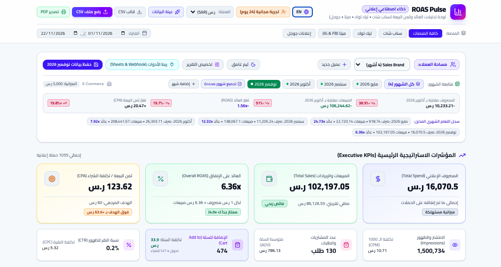

#### 2. تحليلات الأداء البصري والمسار الزمني (Performance Analytics)
مقارنة يومية أو حسب الحملة بين المصروف الإعلاني والمبيعات لاكتشاف أيام الذروة وتقلبات الأداء.

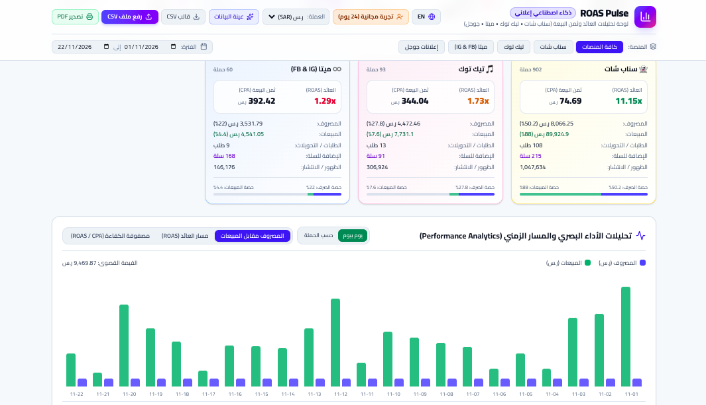

#### 3. التفصيل اليومي واكتشاف إجهاد الإعلانات (Day-by-Day & Ad Fatigue)
مراقبة استقرار الإعلانات يوم بيوم واكتشاف الإعلانات التي تعاني من الإجهاد أو ارتفاع التكلفة مبكراً قبل استنزاف الميزانية.

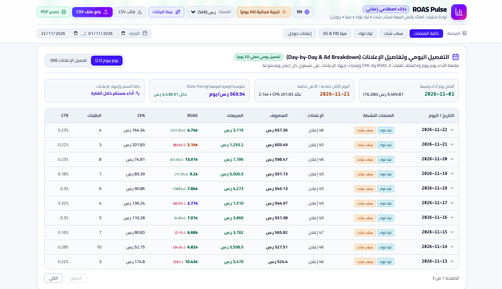

#### 4. جدول تقييم كفاءة الحملات (Campaigns Drilldown)
تحليل هرمي متعدد المستويات (الحملة ← المجموعة الإعلانية ← الإعلان) مع تصنيف تلقائي للحملات بين (**أداء استثنائي Scale Up**، **أداء قوي وناجح**، **يحتاج تحسين**، أو **مهدور / أوقف الحملة**) لتسهيل قرارات توزيع الميزانية.

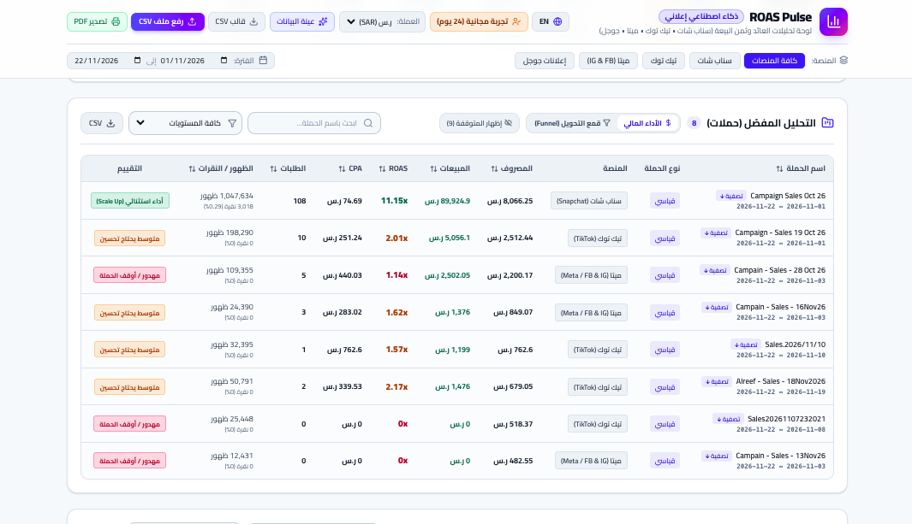

#### 5. مركز القرارات والنمو الذكي (AI Decision & Growth Center)
لوحة قرارات تنفيذية فورية تحدد الإعلانات الجاهزة للتوسع (Scaling)، والإعلانات المستنزفة للميزانية الواجب إيقافها، وأسرع فرص زيادة الأرباح عبر المنصات.

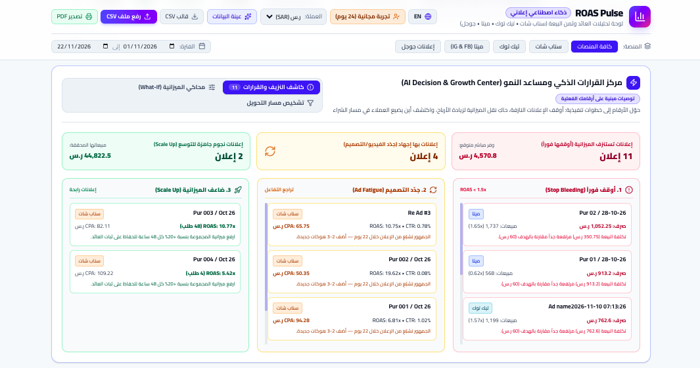

#### 6. مستشار الذكاء الاصطناعي التراكمي (AI Campaign Intelligence)
تحليل عميق للبيانات التاريخية للعميل شهر بعد شهر، مع تقديم تعليق تنفيذي، تحليل الهدر، وتوصيات إعادة توزيع الميزانية.

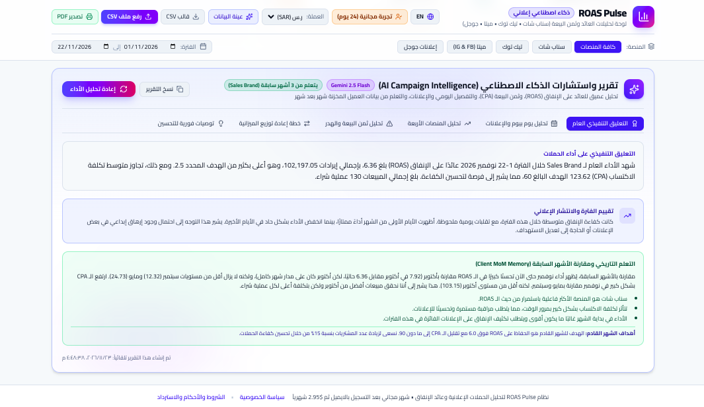

---

### ✨ أبرز المميزات التقنية

- **مساحة عمل العملاء والمتابعة الشهرية (Client MoM Workspace):** إدارة ملفات متعددة للعملاء أو المتاجر وحفظ لقطات الأداء الشهرية مع مقارنة تلقائية بالأشهر السابقة.
- **التكامل والربط الآلي (Integrations):** مزامنة مباشرة مع **Google Sheets**، رفع ملفات **CSV** بقوالب جاهزة، واستقبال البيانات آلياً عبر **Webhooks** (متوافق مع **Zapier** و **Make** و **n8n**).
- **تقارير PDF احترافية قابلة للتخصيص (White-Label):** تصدير تقارير جاهزة للطباعة برسوم بيانية عالية الدقة وهوية مخصصة للوكالة أو المتجر.
- **دعم العملات العربية والعالمية وواجهة ثنائية اللغة:** دعم كامل للريال السعودي (**SAR**)، الجنيه المصري (**EGP**)، الدرهم الإماراتي (**AED**)، والدولار الأمريكي (**USD**) مع تبديل فوري بين العربية والإنجليزية.

---

### 💳 خطة الاشتراك

- **تجربة مجانية لمدة 30 يوماً** عند التسجيل بالبريد الإلكتروني.
- **بعد انتهاء الفترة التجريبية:** اشتراك شهري رمزي بقيمة **$2.95 / شهرياً** فقط مع إمكانية الإلغاء في أي وقت.

---

### 👨‍💻 المطوّر (Author)

تم التصميم والتطوير بواسطة **Mohamed Seteit** — *Performance Marketing Manager*.

- 🌐 **Live App:** [https://roas-pulse.vercel.app/](https://roas-pulse.vercel.app/)
- 🐙 **GitHub:** [@MohamedSeteit](https://github.com/MohamedSeteit)
